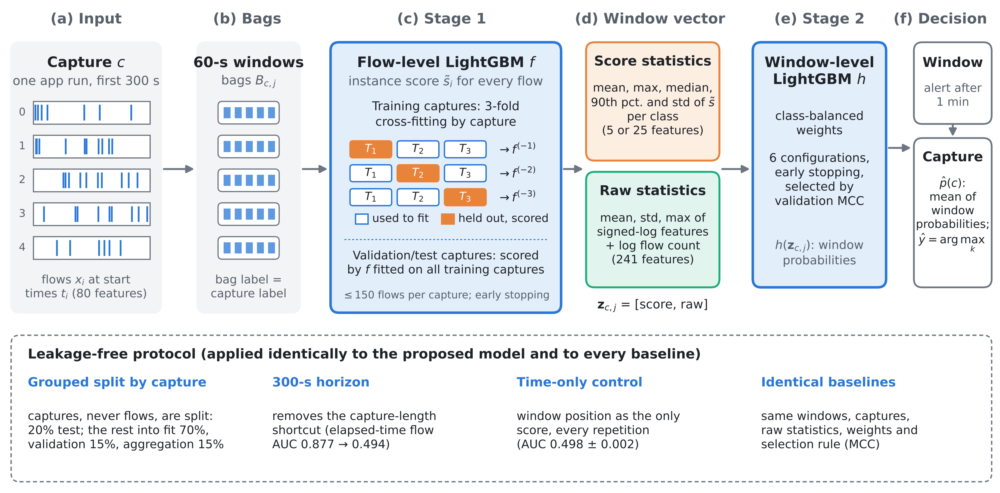

# CF-MIL-Boost

Code, per-repetition results and figures for the paper

> **Cross-Fitted Multiple-Instance Boosting for Session-Level Android Malware Detection from Network Traffic**
> Altyeb Taha, King Abdulaziz University (manuscript submitted to *Electronics*, MDPI).

CF-MIL-Boost treats each one-minute window of an application's network traffic as a bag of flows. A flow-level LightGBM model produces instance scores that are cross-fitted by capture. A window-level LightGBM model then combines window statistics of these scores with robust statistics of the raw flow features. Application (capture) decisions average the window probabilities.



## Evaluation protocol

Every model, including every baseline, is evaluated under the same leakage-controlled protocol:

- **Grouped splits by capture.** Flows are never split. In the main protocol, 20% of captures form the test set, and the rest is divided into fit 70% / validation 15% / aggregation 15%, stratified by category.
- **300-s horizon.** Every capture is restricted to its first 300 s. This removes the capture-length shortcut (elapsed-time flow ROC-AUC 0.877 → 0.494).
- **Time-only control.** In every binary repetition, the window index is also used as the only score (ROC-AUC 0.498 ± 0.002).
- **Identical baselines.** LightGBM, XGBoost, AdaBoost, GBM, gated attention-based MIL (AttnMIL) and a bidirectional GRU receive the same windows, captures and model-selection rule (validation MCC).
- **Unseen malware.** Leave-family-out (5 folds over the 42 families) and leave-one-category-out (4 folds) protocols test generalisation to malware not seen in training.

## Repository layout

| Path | Content |
|---|---|
| `features.txt` | The 80 CICFlowMeter features used as model inputs |
| `build_ctx.py` | Builds the per-flow table (`ctx_flows.parquet`) from the CICAndMal2017 per-capture CSV files, with capture IDs, start times and causal host-context features (used only in the ablation) |
| `repro_stats.py` | Dataset statistics reported in the paper: elapsed-time AUC (full and 300 s), capture lengths, label conflicts → `repro_stats.json` |
| `mil_run.py`, `mil_loop.sh` | Main experiments: flow-level and window-level boosting baselines, ablations, CF-MIL-Boost, random-split check (`python mil_run.py <bin\|cat> <rep> <stage>`) |
| `ext_run.py`, `ext_queue.sh` | Revision experiments: CF-MIL-Boost and window-level LightGBM/XGBoost with saved predictions, timing and SHAP; leave-family-out (`--mode lfo`), leave-one-category-out (`--mode loco`), nested Stage-1 tuning (`--s1 nested`), horizon/window sensitivity (`--H`, `--W`) |
| `deep_run.py` | Deep baselines: gated attention-based MIL (`attn`) and bidirectional GRU (`gru`) on the same windows and splits |
| `mil_st.py`, `ext_st.py` | Summaries and statistics (corrected resampled t-test, Wilcoxon, operating points, per-class metrics, SHAP shares) |
| `make_numbers.py` | Collects every number quoted in the paper from the logged results → `numbers.json`, `tables.json` |
| `mil_pred.py` | Re-runs one repetition of the main experiments and saves predictions (Figure 6) |
| `fig_*.py`, `mil_fig.py` | Figures of the paper |
| `mil/`, `ext/` | Raw per-repetition results (JSON lines), summaries, test predictions and SHAP attributions |
| `figs/`, `paperfigs/` | Figures (PNG and PDF, 600 dpi) |

Stages of `mil_run.py`:

| Stage | Content |
|---|---|
| `A` | Flow-level LightGBM, without and with host-context features |
| `B` | Flow-level XGBoost, without and with host-context features |
| `C` | Flow-level AdaBoost and GBM |
| `D1` | Window-level baselines (LightGBM, XGBoost, AdaBoost, GBM) and the time-only control |
| `D2` | Ablations: mean vote and MIL-LR pooling of flow scores |
| `D3` | CF-MIL-Boost (scores + raw statistics) and the scores-only ablation |
| `E` | Random-flow-split leakage check |

`ext_run.py --mode main` uses the same splits, seeds and code path as `mil_run.py` stages D1/D3 and reproduces their logged metrics exactly. The five-class comparison with the strongest baselines over 10 repetitions combines repetitions 0–4 of `mil_run.py` with repetitions 5–9 of `ext_run.py` (`ext/main_cat10.jsonl`).

## Reproducing the experiments

1. Download the CICAndMal2017 CSV files (CICFlowMeter output per capture) from the Canadian Institute for Cybersecurity: <https://www.unb.ca/cic/datasets/andmal2017.html>. Arrange them as `<root>/<Category>/<Family>/<capture>.csv`, with the categories `Adware`, `Benign`, `Ransomware`, `SMSmalware` and `Scareware`. The dataset is not redistributed here.
2. Install the dependencies:
   ```bash
   pip install -r requirements.txt
   ```
3. Build the flow table and the dataset statistics:
   ```bash
   CFMIL_DATA=/path/to/root python build_ctx.py
   python repro_stats.py
   ```
4. Run the main experiments (10 binary and 5 five-class repetitions; results are appended to `mil/<task>_results.jsonl`):
   ```bash
   TASKS="bin" REPS="0 1 2 3 4 5 6 7 8 9" bash mil_loop.sh
   TASKS="cat" REPS="0 1 2 3 4" STAGES="A B C D1 D2 D3" bash mil_loop.sh
   ```
5. Run the revision experiments (generalisation, deep baselines, nested tuning, sensitivity, predictions/SHAP; results in `ext/`):
   ```bash
   bash ext_queue.sh
   ```
   Run one process at a time on a machine with about 8 GB of memory.
6. Compute the statistics and figures:
   ```bash
   python mil_st.py bin && python mil_st.py cat && python ext_st.py
   python mil_fig.py bin && python mil_fig.py cat
   python mil_pred.py bin 0 D3 && python mil_pred.py bin 0 D1 && python mil_pred.py cat 0 D3 && python mil_pred.py cat 0 D1
   python fig_pipeline.py && python fig_stats.py && python fig_roc.py && python fig_ext.py
   ```

The output directory defaults to the repository folder and can be changed with `CFMIL_WORK`. Random seeds are fixed per repetition (`1000 + rep`; `2000 + fold` for leave-family-out, `3000 + fold` for leave-one-category-out).

The experiments were run with Python 3, LightGBM 4.7.0, XGBoost 3.4.1, scikit-learn 1.9.1, PyTorch 2.15.0, pandas 3.0.5, NumPy 2.5.3, SciPy 1.18.1 and matplotlib 3.11.2, on a two-core machine with 7 GB of memory.

## Citation

If you use this code, please cite the paper (full reference to be added on publication):

```
A. Taha, "Cross-Fitted Multiple-Instance Boosting for Session-Level Android Malware Detection
from Network Traffic," Electronics, 2026 (submitted).
```

## License

MIT License (see `LICENSE`).
